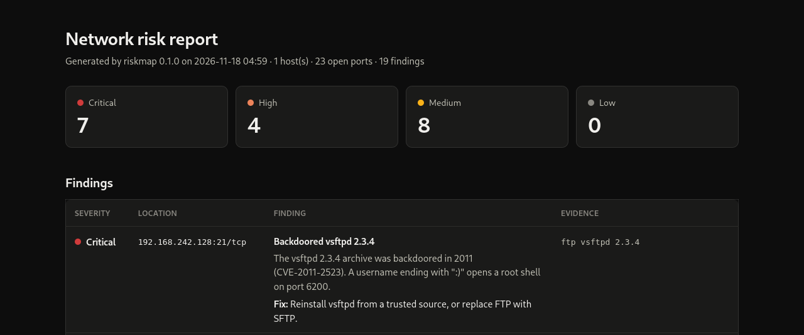
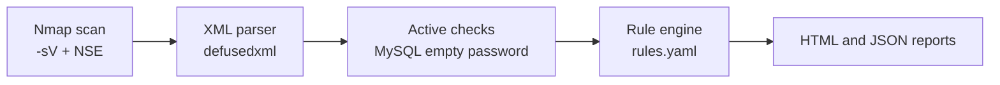

# riskmap

[](https://github.com/Puchopuch/riskmap/actions/workflows/tests.yml)


**riskmap turns an Nmap scan into a prioritized risk report.** It finds the risky services (cleartext protocols, databases without a password, backdoored or end-of-life software), ranks them by severity and explains how to fix each one.



## Why

During my engineering internship, I audited the network of an industrial site with Nmap. Finding what is open is quick. Deciding what is dangerous, how much, and what to do about it takes most of the time. riskmap automates that first triage, so the time goes to verifying and fixing.

## What it does

- Runs Nmap (`-sV` and a few non-intrusive NSE scripts) against an IPv4 address or network
- Parses the XML report into hosts and services
- Runs an **active check** that Nmap can miss: MySQL `root` with an empty password (see [the false negative](#a-false-negative-worth-telling)). It is off by default and limited to the networks listed in a scope file
- Applies **16 rules written in YAML**: Telnet, r-services, SMBv1, anonymous FTP, backdoored vsftpd 2.3.4, exposed databases, outdated OpenSSH, Apache, MySQL and SQL Server...
- Writes an **HTML report** for people and a **JSON report** for tools (SIEM, scripts)
- Returns an exit code you can use in a pipeline (`--fail-on critical`)

## How it works



| Module | Role |
|---|---|
| `scanner.py` | validates the target and runs Nmap |
| `parser.py` | turns the Nmap XML into `Host` and `Service` objects |
| `checks.py` | active checks (speaks the MySQL protocol directly) |
| `rules.py` + `rules.yaml` | loads the rules and matches them against every open port |
| `report.py` + `templates/` | HTML (Jinja2) and JSON reports |
| `cli.py` | the `scan` and `report` commands |

## Quick start

Requirements: Linux (tested on Kali), Python 3.10+ and Nmap.

```bash
git clone https://github.com/Puchopuch/riskmap.git
cd riskmap
python3 -m venv .venv && source .venv/bin/activate
pip install -r requirements.txt

python -m riskmap scan 192.168.242.128             # live Nmap scan, no login attempt
python -m riskmap report scan.xml                  # offline: analyze an existing Nmap XML file
python -m riskmap scan 192.168.242.0/24 --checks --scope scope.txt   # + active checks, only inside the scope
python -m riskmap report scan.xml --fail-on high   # exit code 2 if a high or critical finding exists
python -m riskmap report scan.xml --rules my_rules.yaml
```

Example against Metasploitable 2, with `--checks --scope scope.txt`:

```
[*] Scanning 192.168.242.128 with Nmap... (this can take a few minutes)
[+] Nmap XML saved to scans/scan_20261118_045935.xml
[*] Active checks on, limited to 1 authorized network(s)
[*] 192.168.242.128:3306 MySQL: trying root with an empty password (up to 20 s)...
    result: ACCEPTED

[+] 1 host(s), 23 open ports, 19 findings: 7 critical, 4 high, 8 medium, 0 low
    [CRITICAL] 192.168.242.128:21/tcp    Backdoored vsftpd 2.3.4
    [CRITICAL] 192.168.242.128:23/tcp    Telnet in use
    [CRITICAL] 192.168.242.128:512/tcp   rexec / rlogin / rsh in use
    [CRITICAL] 192.168.242.128:513/tcp   rexec / rlogin / rsh in use
    [CRITICAL] 192.168.242.128:514/tcp   rexec / rlogin / rsh in use
    [CRITICAL] 192.168.242.128:1524/tcp  Shell open without authentication
    [CRITICAL] 192.168.242.128:3306/tcp  MySQL account without password
```

`scope.txt` lists the networks you have written permission to test, one per line (`#` starts a comment). With a scope file, riskmap refuses to scan or log in anywhere else.

The full report is in [`examples/`](examples/): download the HTML file and open it in a browser.

## Writing a rule

A rule matches when all its conditions are true. No Python needed:

```yaml
- id: OPENSSH_OUTDATED
  title: Outdated OpenSSH
  severity: medium
  match:
    banner_contains: OpenSSH
    version_below: "7.4"
  description: This OpenSSH version is very old and affected by several published vulnerabilities.
  recommendation: Upgrade OpenSSH to a supported version.
```

Conditions on a port: `services`, `ports`, `banner_contains`, `banner_not_contains`, `version_below`, `script` + `output_contains`. On a whole host: `host_script` + `output_contains`. Unknown conditions are refused, so a typo cannot silently match every port.

## Security by design

A security tool reads data that attackers control: service banners, XML files, rule files. Every input is treated as hostile, and every protection has a test.

| Threat | Protection |
|---|---|
| Command injection through the target | Nmap is called with a list of arguments, never through a shell |
| Argument injection (`--script=evil.nse` as a target) | the target must be a valid IPv4 address or network |
| XML bomb ("billion laughs") in a report | parsed with `defusedxml`, entities are refused |
| Code execution from a rules file | `yaml.safe_load`, never `yaml.load` |
| Login attempts on systems you may not test | active checks are off by default and refused outside the scope file |
| Stored XSS through a malicious banner | Jinja2 with `autoescape=True` |
| Leaking audit data | `scans/` and `reports/` are git-ignored |
| Compromised dependency in CI | the workflow token is limited to `contents: read` |

## A false negative worth telling

On Metasploitable 2, MySQL accepts `root` with an empty password, yet Nmap's `mysql-empty-password` script reported nothing. In debug mode (`-d`), it showed `receiveGreeting(): failed` and `TIMEOUT`. Measuring the server greeting gave 10 seconds, while the script's timeout is hard-coded to 5 (`socket:set_timeout(5000)`). The cause: MySQL 5.0 looks up the client's IP in reverse DNS before answering, and the lab has no DNS server. Confirmed: once the client's IP was added to the target's /etc/hosts, the greeting arrived in 0.0 s instead of 10.0 s.

riskmap's own check (`checks.py`) speaks the MySQL handshake directly and waits up to 20 seconds. It found the account. Lesson: a scanner that reports nothing has not proven anything.

A second false negative was hiding in riskmap itself: it skipped its own check whenever Nmap's script had written anything, even an error message. It now skips only when Nmap actually found the empty password, and a regression test keeps it that way.

## Tested on a clean network

Metasploitable is vulnerable on purpose: it shows that riskmap finds problems, not that it stays quiet when there are none. [`lab/clean-network/`](lab/clean-network/) starts six up-to-date services with Docker, configured the way they should be: real passwords, no anonymous access, no port published on the host.

```bash
cd lab/clean-network
printf "LAB_PASSWORD=%s\n" "$(openssl rand -hex 16)" > .env   # random password, git-ignored
sudo docker compose up -d --wait
cd ../.. && python -m riskmap scan 172.30.0.0/28 --checks --scope lab/clean-network/scope.txt
```

Result:
| Service, as seen by Nmap | riskmap |
|---|---|
| MySQL 8.4.13 | medium: database reachable over the network (root with an empty password: refused) |
| MariaDB 11.4.13 | medium: database reachable over the network (root with an empty password: refused) |
| PostgreSQL (version hidden until login) | medium: database reachable over the network |
| Apache httpd 2.4.71 | nothing |
| nginx 1.30.6 | nothing |
| OpenSSH 10.3 | nothing |

No false alarm: no critical or high finding, and no outdated-version finding. The three medium findings are real: a database reachable from the network is an exposure its owner should justify. The seventh host is the scanning machine itself (the gateway of the Docker network), with no open port.

The test itself had a trap: MySQL took about a minute before listening on the network. A scan started earlier would have missed port 3306 and looked cleaner than the truth, so the lab waits until each database accepts connections (`--wait` and healthchecks).

Six services are a small sample: this shows that riskmap does not cry wolf on a modern stack, not that it never will. Version rules on distribution packages remain the main risk (see [Limitations](#limitations-and-roadmap)).

## Lab

Kali Linux and Metasploitable 2 on VMware, on a host-only network, plus the [clean Docker network](#tested-on-a-clean-network). Metasploitable is vulnerable on purpose: never expose it to a real network.

## Tests

```bash
pip install -r requirements-dev.txt
python -m pytest -v
```

37 tests, no network needed (a fake MySQL server runs on localhost). GitHub Actions runs them on Python 3.10, 3.12 and 3.13 at every push.

## Limitations and roadmap

- Version-based rules can give false positives: Linux distributions backport security fixes without changing the version number, so `OpenSSH 4.7p1 Debian 8ubuntu1` may be patched. Verify before reporting.
- IPv4 and TCP only, on Nmap's 1,000 most common ports.
- One active check so far (MySQL). Next: PostgreSQL default credentials, Redis without authentication, the SNMP `public` community (UDP).
- Planned: CVE lookup from the CPE identifiers, comparison between two scans.

## Legal

Only scan networks you own or have written permission to test. Scanning or testing systems without authorization can be an offence (in France, articles 323-1 and following of the Code pénal).

## Author

Pascal Amouzoun, network and security engineer (EIGSI 2026), student in the Specialized Master in Cybersecurity and Cyberdefense at Télécom Paris. [LinkedIn](https://www.linkedin.com/in/pascal-amouzoun-0a59b5237)

License: MIT
